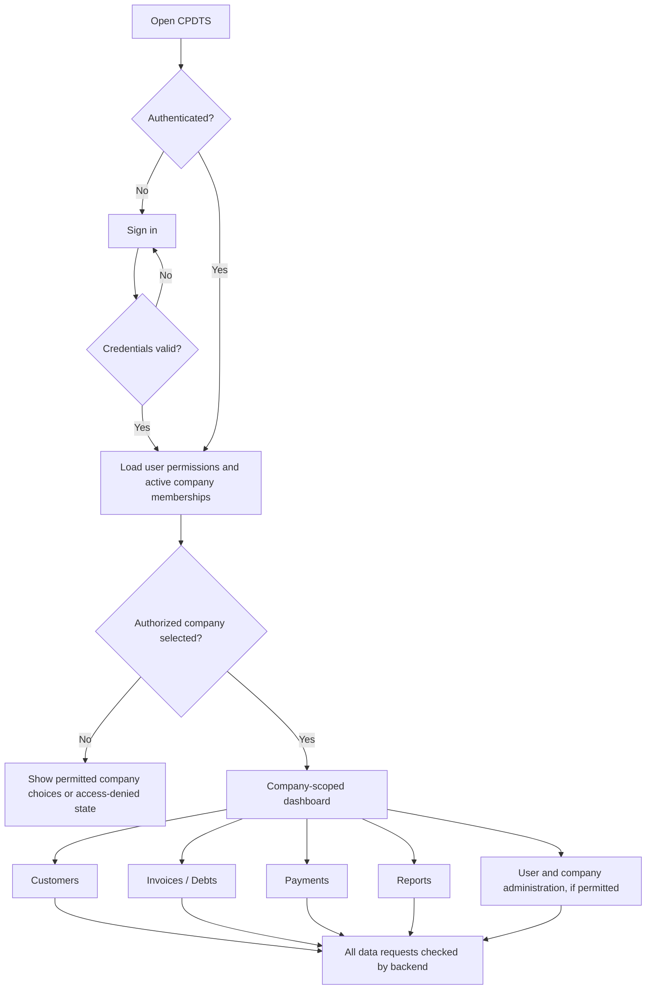
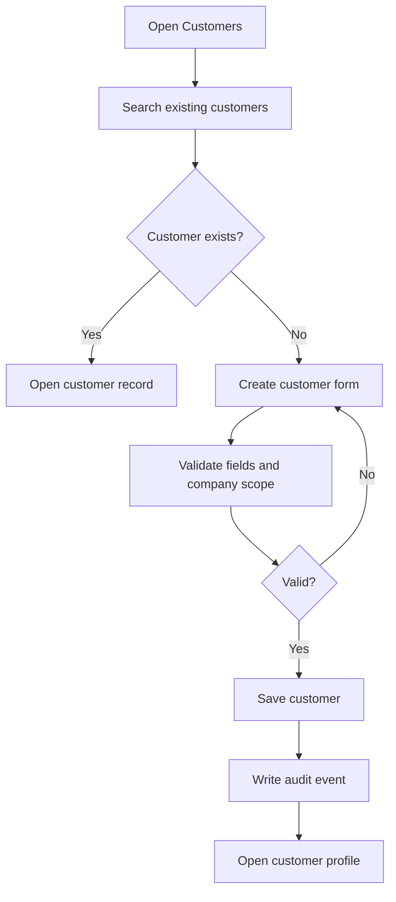
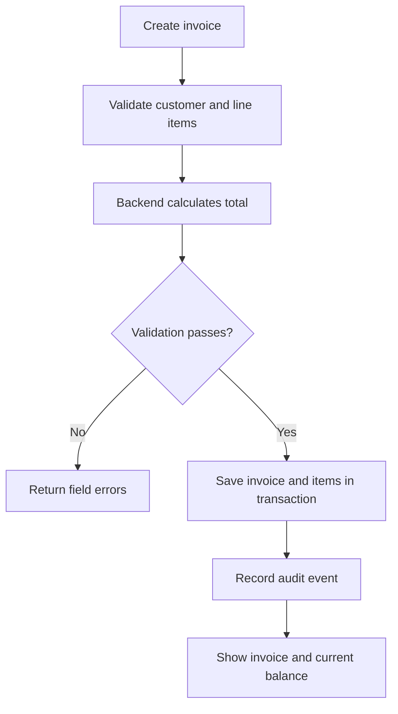
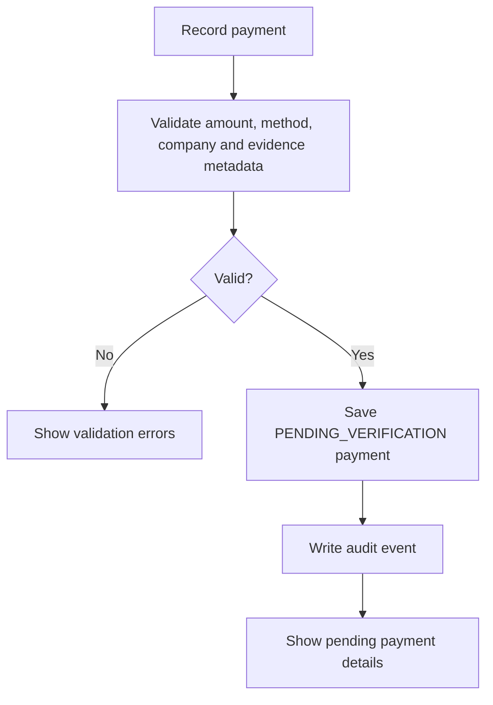
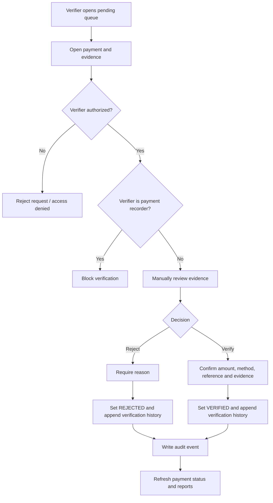

# Application Flow
## Customer Payment & Debt Tracking System (CPDTS)

- **Status:** Proposed flow for review
- **Version:** 1.0
- **Last updated:** 27 October 2026

## 1. Purpose

This document describes how users move through CPDTS and how key financial records change state. UI routes are suggestions; the final route names can change without changing the business rules.

## 2. Global application flow



## 3. Sign-in and company selection

1. User opens the application.
2. If not authenticated, the user sees the sign-in form.
3. Backend validates credentials and establishes the approved authentication session/token.
4. Backend determines permissions and active company memberships.
5. If the user has access to one company, the app may select it automatically.
6. If the user has access to multiple companies, show only authorized companies.
7. Every subsequent API request must enforce company scope on the backend.
8. If access is revoked, subsequent requests must fail even if the user still has an old browser page open.

## 4. Customer creation flow



Customer records belong to a company. Do not allow an invoice to link a customer from another company.

## 5. Invoice/debt creation flow

1. Authorized user selects the active company.
2. User opens the customer and chooses **Create Invoice/Debt**.
3. User enters invoice dates, description, and line items.
4. Frontend shows a provisional total for convenience.
5. Backend validates the customer/company relationship, dates, quantities, unit prices, and allowed status transition.
6. Backend calculates the authoritative total.
7. Backend assigns or validates a company-unique invoice number.
8. Invoice is saved in the approved initial status and an audit event is written.
9. If issued, the invoice becomes eligible for payment allocation.
10. Any correction/void action follows a controlled, audited workflow.



## 6. Payment recording flow

1. Authorized user opens **Payments → Record Payment**.
2. User selects a customer and enters amount, received date, method, and available reference/evidence.
3. Supported methods: cash, bank transfer, mobile money.
4. Backend validates positive amount, company scope, required method-specific fields, and duplicate-reference warnings/rules.
5. Backend stores the payment as `PENDING_VERIFICATION`.
6. The system records the creator and audit event.
7. The payment does not reduce any invoice balance while pending.
8. User sees the payment reference and pending status.



## 7. Payment verification flow



Important: the verifier must be a different user from the recorder. The backend must enforce this even if someone sends a crafted API request.

### Verification outcomes

- **Pending:** awaiting review; no invoice balance effect.
- **Verified:** manual review accepted; eligible for allocation according to the approved allocation workflow.
- **Rejected:** review failed; no invoice balance effect.
- **Reversed:** previously verified payment has been reversed through an authorized, audited workflow.

A rejected payment should not be edited into a verified payment without a traceable new decision. The exact retry/re-submission workflow must be approved.

## 8. Payment allocation flow

A payment may cover several invoices; an invoice may be settled by several payments.

1. Authorized user opens a verified payment.
2. User selects one or more eligible invoices belonging to the same company and customer, according to the approved policy.
3. User enters allocation amounts.
4. Backend locks/rechecks relevant payment and invoice records within a transaction.
5. Backend confirms the payment is verified and not reversed.
6. Backend confirms allocation sum does not exceed the available payment amount.
7. Backend confirms each invoice's remaining balance is not exceeded unless an approved credit policy allows it.
8. Backend saves allocations atomically and writes audit events.
9. The UI refreshes the derived invoice balances and payment unallocated amount.

```mermaid
flowchart TD
    A[Choose verified payment] --> B[Choose eligible invoice(s)]
    B --> C[Enter allocation amounts]
    C --> D[Backend transaction and locking]
    D --> E{Same company and valid state?}
    E -- No --> F[Reject allocation]
    E -- Yes --> G{Within payment and invoice limits?}
    G -- No --> F
    G -- Yes --> H[Save allocations atomically]
    H --> I[Write audit events]
    I --> J[Recalculate displayed balances]
```

## 9. Invoice balance and overdue flow

- **Outstanding balance:** invoice total minus valid allocations from verified, non-reversed payments, under the approved reversal model.
- **Partially paid:** valid allocated amount is greater than zero and outstanding balance remains greater than zero.
- **Paid:** outstanding balance is zero under the approved rounding policy.
- **Overdue:** outstanding balance is positive and the due date is before the defined business date.
- **Unpaid:** no valid allocation has reduced the invoice balance.

The backend is the authoritative source for balances and status. Do not store a user-editable balance.

## 10. Reversal/correction flow

1. Authorized user opens the eligible financial record.
2. User selects **Request/Perform Reversal** according to the approved permission policy.
3. User provides a mandatory reason.
4. Backend validates the state and permissions.
5. Backend records the reversal/correction event and reverses its financial effect transactionally.
6. Audit history remains available.
7. Reports and balances update consistently.

Do not hard-delete verified payments or issued invoices.

## 11. Reports flow

1. User selects a report and permitted company scope.
2. User chooses date range and available filters.
3. Backend applies authorization and company filters before calculating results.
4. Report labels distinguish recorded, verified, allocated, reversed, and outstanding amounts.
5. User views results and exports only to approved formats.
6. Export activity may be audited for sensitive reports.

## 12. Error and exceptional flows

- Expired session → request sign-in again.
- Inactive membership → deny company data access.
- Cross-company record ID → deny without revealing private data.
- Duplicate form submission → detect where possible and avoid duplicate financial records.
- Concurrent allocation/verification → one transaction succeeds or the operation is safely retried; balances remain consistent.
- Database unavailable → show a safe error and do not claim the operation succeeded.
- Evidence unavailable/invalid → keep payment pending or reject according to the approved workflow; never silently verify it.

## 13. Proposed navigation

- Dashboard
- Customers
- Invoices / Debts
- Payments
  - Record Payment
  - Pending Verification
  - Payment History
  - Reversals (permission-gated)
- Reports
- Administration (permission-gated)
  - Users and Memberships
  - Company Settings
  - Audit Log

Route paths and labels are provisional. The design should make the active company visible at all times.
