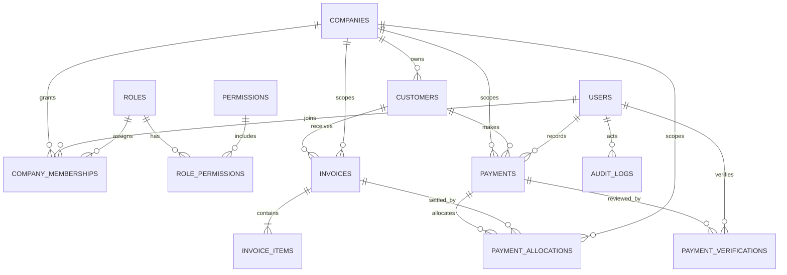

# Backend & Database Schema
## Customer Payment & Debt Tracking System (CPDTS)

- **Status:** Proposed logical schema; must be reviewed before SQL migrations
- **Version:** 1.0
- **Last updated:** 27 October 2026
- **Database:** PostgreSQL (proposed)

> This is a logical design document, not a claim that a database has already been installed or created. Do not generate production SQL until the schema decisions and repository audit have been reviewed.

## 1. Schema design goals

- Enforce company isolation at the database and backend layers.
- Preserve financial history and prevent silent deletion.
- Support partial payments and one payment allocated to multiple invoices.
- Separate payment recording from payment verification.
- Use fixed-precision money values.
- Make important constraints explicit and testable.

## 2. Proposed entities

### 2.1 `companies`
Purpose: the organizations whose data CPDTS manages.

Suggested fields:
- `id` — primary key
- `code` — unique code, initially `JMX` and `KAM`
- `legal_name`
- `display_name`
- `status`
- `created_at`, `updated_at`

Constraints: unique `code`; required name/code; valid status.

### 2.2 `users`
Purpose: user identities for authentication and accountability.

Suggested fields:
- `id` — primary key
- `email` or approved username — unique login identifier
- `password_hash`
- `full_name`
- `status`
- `created_at`, `updated_at`, optional `last_login_at`

Do not store plaintext passwords. Confirm whether one user may have more than one login identifier.

### 2.3 `roles`, `permissions`, `role_permissions`
Purpose: permission-based authorization.

`roles`: `id`, `code`, `name`, description.
`permissions`: `id`, `code`, description.
`role_permissions`: `role_id`, `permission_id` with a composite primary key.

Role names are not a substitute for explicit backend permission checks. The final role catalogue must be approved.

### 2.4 `company_memberships`
Purpose: connects users to companies and defines their company-level access.

Suggested fields:
- `id` — primary key
- `company_id` — foreign key
- `user_id` — foreign key
- `role_id` or a membership-to-role join if multiple roles per company are required
- `status` (active/inactive)
- `created_at`, `created_by`

Constraints: unique active membership according to the chosen model; indexes on user/company. Decide whether a user may hold multiple roles within one company before choosing the exact keys.

### 2.5 `customers`
Purpose: customer records within a company.

Suggested fields:
- `id`
- `company_id`
- `customer_code` (optional, unique within company)
- `display_name`
- approved contact fields such as phone, email, address
- `notes` (optional)
- `status`
- `created_at`, `updated_at`, `created_by`, `updated_by`

Constraints: company-scoped uniqueness for customer code where used. Avoid collecting sensitive identity data without a confirmed business need.

### 2.6 `invoices`
Purpose: invoices or debt records owed by customers.

Suggested fields:
- `id`
- `company_id`
- `customer_id`
- `invoice_number`
- `issue_date`
- `due_date`
- `currency_code` (initially `TZS`)
- `status` (exact lifecycle to be approved)
- `description`/`notes`
- `created_at`, `updated_at`, `created_by`, `updated_by`
- optional `issued_at`, `voided_at`, `void_reason`

Constraints:
- unique `(company_id, invoice_number)`;
- customer must belong to the same company;
- `due_date` rule to be approved;
- do not expose a directly editable balance field.

### 2.7 `invoice_items`
Purpose: line items used to calculate invoice totals.

Suggested fields:
- `id`
- `company_id`
- `invoice_id`
- `description`
- `quantity` using approved numeric precision
- `unit_price` using fixed-precision numeric
- optional `line_total` only if calculated/validated consistently
- `sort_order`

Invoice totals must be calculated by backend logic from valid line items. If totals are stored for reporting/performance, define how they are maintained and tested.

### 2.8 `payments`
Purpose: record incoming money before or after manual verification.

Suggested fields:
- `id`
- `company_id`
- `customer_id` (if the business model requires payment to be customer-specific)
- `payment_number` unique within company
- `amount` `NUMERIC(14,2)` and greater than zero
- `currency_code` initially `TZS`
- `method` enum/check: `CASH`, `BANK_TRANSFER`, `MOBILE_MONEY`
- `reference_number` nullable where method permits
- `received_at` and `recorded_at`
- `status`: `PENDING_VERIFICATION`, `VERIFIED`, `REJECTED`, `REVERSED`
- `recorded_by` (user FK)
- optional evidence metadata/storage key
- notes and timestamps

Constraints:
- positive amount;
- valid status and method;
- company scope;
- payment number unique within company;
- if customer-scoped allocations are required, enforce that allocations use invoices belonging to that same customer as well as the same company.

### 2.9 `payment_verifications`
Purpose: immutable decision history for verification/rejection and possibly later review decisions.

Suggested fields:
- `id`
- `company_id`
- `payment_id`
- `verifier_id`
- `decision` (e.g. `VERIFIED`, `REJECTED`)
- `reason`/notes
- `evidence_reviewed` or evidence references, if appropriate
- `created_at`

Rules:
- verifier differs from payment recorder;
- verifier must have the required permission and active company access;
- each decision is appended as history rather than erasing previous decisions;
- define whether a payment can be resubmitted after rejection and how that is represented.

The recorder/verifier inequality is a cross-table rule and generally needs backend transactional logic or a database trigger; a simple row-level `CHECK` cannot compare against another table.

### 2.10 `payment_allocations`
Purpose: join payments to invoices and record how much of a payment settles each invoice.

Suggested fields:
- `id`
- `company_id`
- `payment_id`
- `invoice_id`
- `amount` `NUMERIC(14,2)` and greater than zero
- `created_at`, `created_by`
- optional reversal/void linkage if allocation corrections are supported

Relationship:
- one payment can have many allocations;
- one invoice can have many allocations;
- therefore payments and invoices are many-to-many through `payment_allocations`.

Constraints and rules:
- payment and invoice belong to the same company;
- amount is positive;
- allocation sum cannot exceed the eligible verified payment amount;
- invoice allocation sum cannot exceed remaining invoice balance unless approved credit handling exists;
- aggregate limits need transaction-safe backend logic and locking; ordinary `CHECK` constraints cannot sum other rows.

### 2.11 `audit_logs`
Purpose: trace sensitive and financial actions.

Suggested fields:
- `id`
- `company_id` nullable only for platform-wide actions
- `actor_user_id`
- `action`
- `entity_type`, `entity_id`
- `occurred_at`
- `reason` where applicable
- structured `before_data`/`after_data` or a minimized change summary
- `request_id`/correlation ID

Protect audit logs from normal editing/deletion. Avoid logging secrets or unnecessary personal/payment evidence data.

### 2.12 Optional supporting tables
- `payment_evidence`: if multiple evidence files/links per payment are needed.
- `invoice_status_history`: if invoice lifecycle changes need dedicated history.
- `payment_reversals`: if reversals require a dedicated structured workflow.
- `number_sequences`: if invoice/payment number allocation requires transactional per-company sequences.

Do not add optional tables without explaining the use case and lifecycle.

## 3. Relationship summary

- `companies` 1 → many `company_memberships`
- `users` 1 → many `company_memberships`
- `companies` 1 → many `customers`
- `customers` 1 → many `invoices`
- `invoices` 1 → many `invoice_items`
- `companies` 1 → many `payments`
- `payments` 1 → many `payment_verifications`
- `payments` many ↔ many `invoices` through `payment_allocations`
- `users` relate to financial records as creator, updater, verifier, and audit actor
- `roles` many ↔ many `permissions` through `role_permissions`

## 4. ERD (logical draft)

This diagram is conceptual. Exact cardinalities, nullable relationships, composite foreign keys, and whether a payment must be attached to a customer must be finalized before migrations.

## 5. Company isolation strategy

Recommended minimum:
1. Include `company_id` on each company-owned business table.
2. Derive the user's permitted company scope from trusted server-side identity and active memberships.
3. Apply scope in every service/repository query, not just in UI filters.
4. Use composite foreign keys or equivalent constraints to stop records from linking across companies.
5. Test direct-ID attacks, list queries, reports, counts, exports, and updates across company boundaries.
6. Consider PostgreSQL Row-Level Security (RLS) as an additional layer after the application connection/session design is understood. RLS is not a replacement for sound backend authorization.

## 6. Financial calculations and status derivation

- Invoice total = sum of valid invoice item totals under the approved rounding policy.
- Valid allocated amount = sum of allocations attached to eligible verified and non-reversed payments, adjusted for approved allocation reversals.
- Outstanding balance = invoice total − valid allocated amount.
- Payment unallocated amount = eligible verified payment amount − valid allocations.
- Overdue = outstanding balance > 0 and due date is earlier than the business date.
- The backend is authoritative for these calculations.
- Decide whether totals/balances are computed at query time or stored as derived values; if stored, define a safe reconciliation strategy.

## 7. PostgreSQL constraints vs backend logic

### Suitable for database constraints
- Primary keys and foreign keys.
- Required fields (`NOT NULL`).
- Positive amount/quantity checks.
- Valid enum/check values.
- Unique company code and company-scoped invoice/payment/customer numbers.
- Same-company foreign-key integrity using composite keys where designed.
- Basic date and field-level rules.

### Requires transactional backend logic, locking, triggers, or a carefully designed ledger
- Allocation sum must not exceed payment available amount.
- Invoice allocations must not exceed outstanding balance.
- Invoice totals aggregated from multiple line items.
- Payment verifier must differ from recorder.
- Verify/reject plus financial state transitions must be atomic.
- Correct handling of reversals and previously created allocations.
- Duplicate request/idempotency handling.

Do not assume a `CHECK` constraint can safely enforce sums across multiple rows or tables.

## 8. Proposed migration sequence

Use Flyway versioned migrations, reviewed and tested against the selected PostgreSQL version. Exact filenames can change if the repository already has migrations.

1. `V1__create_identity_and_company_tables.sql`
   - companies, users, roles, permissions, memberships, role-permission relationships.
2. `V2__create_customer_and_invoice_tables.sql`
   - customers, invoices, invoice items, indexes, company-scoped constraints.
3. `V3__create_payment_tables.sql`
   - payments, verification history, allocations, evidence metadata if approved.
4. `V4__create_audit_and_supporting_tables.sql`
   - audit log and approved supporting history tables.
5. `V5__add_seed_reference_data.sql`
   - only safe reference data, such as the two company records and approved role/permission definitions; no plaintext credentials.
6. Later migrations only when tests or approved changes require them.

Migration order must respect foreign-key dependencies. If the repository already contains Flyway migrations, audit them and plan forward-only additions rather than replacing applied migrations.

## 9. Indexing recommendations

Consider indexes for:
- `company_memberships(user_id, company_id, status)`;
- business table `company_id`;
- `customers(company_id, display_name)` or appropriate search strategy;
- `invoices(company_id, customer_id, due_date, status)`;
- `payments(company_id, status, received_at)`;
- `payment_allocations(company_id, payment_id)` and `(company_id, invoice_id)`;
- `payment_verifications(company_id, payment_id, created_at)`;
- `audit_logs(company_id, occurred_at)`.

Validate indexes using realistic queries and query plans; do not add indexes without considering write cost.

## 10. Seed data and bootstrap

- Seed the two known companies with codes `JMX` and `KAM`, after names and codes are approved.
- Seed only approved roles/permissions.
- Do not seed a known admin password in SQL.
- Create the first platform administrator through a secure, documented bootstrap process, with a forced credential setup where practical.
- Never use production customer or payment records as development seed data.

## 11. Required schema review decisions

Before writing migrations, approve:
- ID strategy (UUID vs identity/bigint).
- One or multiple roles per user/company.
- Whether customer records are company-specific.
- Whether a payment must be assigned to a customer before allocation.
- Whether payment allocations must target invoices for the same customer.
- Invoice lifecycle and line-item editing rules.
- Rejected payment resubmission behavior.
- Reversal model for payments and allocations.
- Overpayment/credit policy.
- Evidence storage and retention.
- Exact money rounding rules.
- Whether RLS is required.
